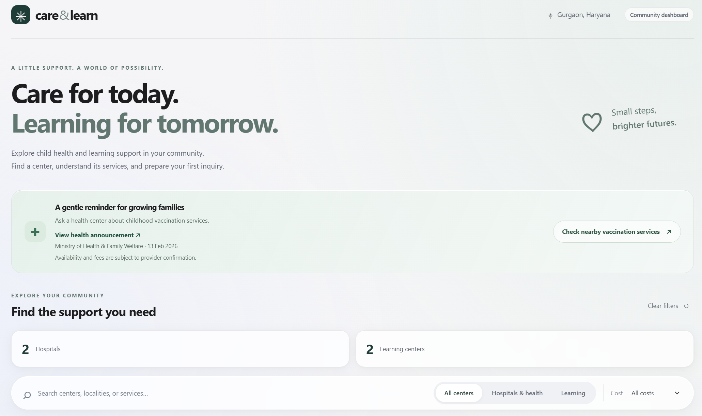
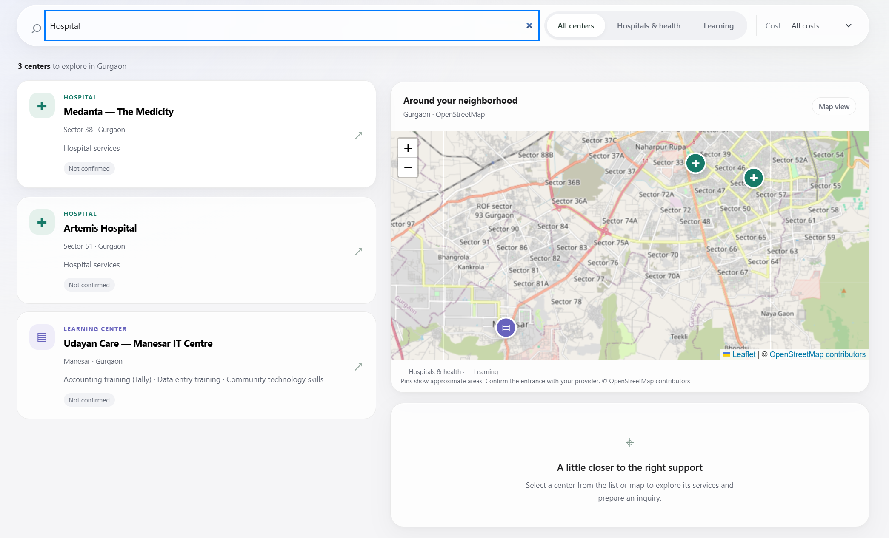

# Care & Learn

> **Stress-Free Support for Parents: Child Healthcare & Tutoring in One Place**

Helps caregivers in Gurgaon find local child health centers and free learning support, inspect verified practical details, and prepare a direct WhatsApp inquiry.

The public dashboard features verified provider records, real-time category/cost filtering, proactive seasonal vaccination alerts, and integrated Leaflet map discovery. All information is cited with verified sources.

---

## 📱 User Interface & Map

| Care & Learn Dashboard | Interactive Leaflet Map & Search |
| :---: | :---: |
|  |  |

---

## 🏛️ Architecture

A single FastAPI/Uvicorn process serves both the static frontend and RESTful backend APIs on one origin.

- **Persistent Store:** SQLite (`backend/data/caregiving.sqlite3`) holds the directory and AI-discovered providers.
- **Search & Discovery:** `/api/reveal` delivers instant offline searches; `/api/discover` executes grounded AI web search with strict coordinate and source evidence validation.
- **Synchronized UI:** Cards and Leaflet map pins share the identical backend response state.
- **Direct Contact:** 1-tap WhatsApp deep link (`wa.me`) with prefilled, polite inquiry templates.

---

## 📂 Directory Structure

```text
.
├── frontend/                     # Runnable client (HTML5/CSS3/Vanilla JS)
│   ├── index.html                # Single-page UI markup
│   ├── styles.css                # Responsive, parent-friendly styling
│   ├── app.js                    # Leaflet map, filters, API client, inquiry logic
│   ├── centers.json              # Starting directory fixtures
│   └── README.md                 # Frontend review notes
├── backend/                      # FastAPI Python backend
│   ├── app/                      # Application modules
│   │   ├── main.py               # FastAPI entrypoint, route registration & static mounts
│   │   ├── config.py             # Server settings, timeouts, and domain allowlists
│   │   ├── database.py           # SQLite connection & schema lifecycle
│   │   ├── repository.py         # Bound SQL persistence & deduplication
│   │   ├── schemas.py            # Pydantic request/response contracts
│   │   ├── search.py             # Filter matching & Haversine distance ranking
│   │   ├── discovery.py          # Discovery orchestration & query caching
│   │   ├── ai.py                 # Grounded AI web-search adapter
│   │   ├── evidence.py           # Coordinate extraction, source validation & redirect checks
│   │   ├── errors.py             # Standardized error definitions
│   │   └── seed.py               # CLI tool for database initialization
│   ├── data/                     # Data storage (git-ignored SQLite database)
│   │   └── providers.json        # Verified seed directory
│   ├── tests/                    # 110+ comprehensive pytest test suites
│   ├── requirements.txt          # Production dependencies (FastAPI, Uvicorn, Pydantic, HTTPX)
│   ├── requirements-dev.txt      # Development dependencies (pytest, anyio)
│   └── README.md                 # In-depth backend architecture & API reference
└── docs/                         # Documentation & assets
    └── figures/                  # UI screenshots & visual diagrams
        ├── UI_care_and_learn.png
        └── map_UI.png
```

---

## 🚀 Set Up and Run

### 1. Prerequisites

- Python 3.10+ (tested on Python 3.14)
- Internet connection for initial dependency installation and map tile loading.

### 2. Quickstart (PowerShell / Windows)

From the project root directory:

```powershell
# 1. Create and activate Python virtual environment
python -m venv .venv
.\.venv\Scripts\Activate.ps1

# 2. Install backend dependencies
pip install -r backend/requirements.txt -r backend/requirements-dev.txt

# 3. Initialize and seed the SQLite directory
python -m backend.app.seed --file backend/data/providers.json

# 4. (Optional) Set your OpenAI API key for live AI discovery
# Without this, offline search, stored directory, and filters work completely.
$env:OPENAI_API_KEY = "your-api-key-here"
$env:CARE_LEARN_AI_MODEL = "gpt-4.1-mini"

# 5. Start the FastAPI server
python -m uvicorn backend.app.main:app --host 127.0.0.1 --port 4173
```

Open your browser to:
👉 **[http://127.0.0.1:4173](http://127.0.0.1:4173)**

- API Documentation (Swagger / OpenAPI): **[http://127.0.0.1:4173/docs](http://127.0.0.1:4173/docs)**
- Health & Readiness check: **[http://127.0.0.1:4173/api/health](http://127.0.0.1:4173/api/health)**

---

## 🧪 Running Tests

Run the full backend test suite:

```powershell
.\.venv\Scripts\python.exe -m pytest backend/tests -q
```
